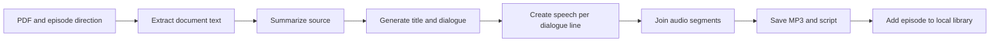
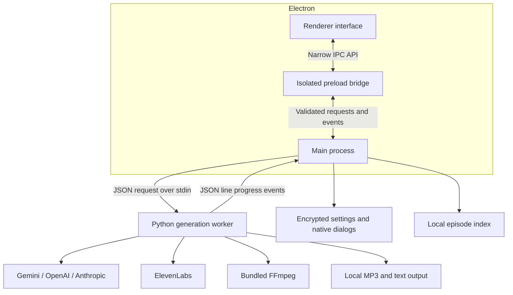

# POD

POD is a local first desktop studio that turns a text based PDF into a conversational, two voice podcast. A user attaches a document, optionally describes the intended audience or tone, and receives a playable MP3 together with the generated script.

The application runs directly on the user’s computer. It has no login, hosted database, application server, or cloud storage layer. Users connect their own AI accounts, choose where completed files are saved, and retain control of the generated artifacts.

## Product experience

POD organizes the workflow into four focused areas:

- **Chat** is the production workspace. It accepts a PDF and optional creative direction, reports each generation stage, and plays the completed episode in the conversation.
- **Podcasts** is the local episode library. It lists completed audio, provides playback controls, and reveals the MP3 and script in the operating system’s file browser.
- **Docs** explains setup, source document requirements, prompt guidance, privacy behavior, provider usage, and common errors inside the application.
- **Settings** manages the active text provider, encrypted API credentials, and the local output destination.

The interface uses a white, black and blue visual system in light and dark themes. It follows the system theme until the user picks one with the header toggle. Typography is Space Grotesk for headings, Manrope for interface text and JetBrains Mono for labels, all bundled locally under the SIL Open Font License. Compact navigation and page headings leave most of the window available for the conversation, episode library, and documentation.

## Generation workflow

1. The user selects a PDF through the native file picker and submits an optional direction of up to 2,000 characters.
2. The generation worker validates the selected file and extracts its text with PyMuPDF.
3. The active language model creates a grounded summary of the source document.
4. The same provider creates a short episode title and an approximately 1,200 word dialogue between Dorothy and Will.
5. The worker parses dialogue lines by speaker and sends each line to the matching ElevenLabs voice.
6. FFmpeg joins the returned speech segments without re-encoding them.
7. POD writes the final MP3 and plain text script to the configured output directory and records the episode in the local library.

Progress travels back to the interface as structured events, so the user can see whether POD is reading, summarizing, writing, voicing, or exporting the episode.

## Application architecture

POD separates desktop access, interface code, and generation work into distinct process boundaries.

### Renderer interface

The renderer owns presentation and interaction state for Chat, Podcasts, Docs, and Settings. It never receives Node.js access or raw filesystem capabilities. It asks the preload bridge for a small set of operations and listens for structured generation events.

The BrowserWindow uses context isolation, disables Node integration, enables the Electron sandbox, blocks new windows, and applies a restrictive content security policy. These settings keep untrusted document names and generated content inside normal DOM text rendering rather than exposing privileged desktop APIs.

### Preload bridge

The preload layer exposes a narrow API for settings, native file dialogs, generation, podcast listing, and revealing completed files. This boundary keeps Electron IPC details out of the UI and limits which main process operations the renderer can request.

### Electron main process

The main process owns privileged desktop behavior:

- native PDF and output folder selection;
- encrypted API credential persistence;
- validation of provider, file, folder, and generation requests;
- lifecycle management for the generation worker;
- translation of worker output into renderer progress events;
- local episode indexing and safe reveal operations.

Only one generation worker may run at a time. The main process verifies that a selected PDF exists, that the configured output directory is still available, and that both the active text provider key and ElevenLabs key have been saved before starting work.

### Python generation worker

The worker performs the compute and provider dependent stages. It accepts one JSON request on standard input and emits newline delimited JSON events on standard output. API keys are supplied only for the lifetime of that child process; the worker does not load credentials from `.env` or persist them.

This protocol keeps the Electron layer independent from Python SDK behavior and gives the interface a stable stream of progress, completion, and error events. In the packaged application, the worker is distributed as a standalone executable.

## Provider architecture

POD supports three interchangeable text providers and one speech provider.

| Responsibility | Providers | Data received |
| --- | --- | --- |
| Document summary, title, and dialogue | Google Gemini, OpenAI, or Anthropic | Extracted PDF text, generated summary, and optional episode direction |
| Speech synthesis | ElevenLabs | Individual Dorothy and Will dialogue lines |

Only the selected text provider is called during a generation. Each integration is normalized behind the same internal text generation contract, which returns plain text or raises a provider error. This keeps the rest of the pipeline independent of provider specific SDK response formats.

The dialogue contract requires every spoken line to begin with `Dorothy:` or `Will:`. The worker rejects a response that contains no valid dialogue, removes simple stage directions from spoken text, and maps each speaker to a dedicated ElevenLabs voice.

## Local data and security

POD stores application preferences and the episode index in Electron’s per user application data location. API keys are encrypted with Electron `safeStorage`, which delegates encryption to the operating system. Saved credentials are decrypted only when a generation starts and are passed directly to the worker process.

Generated media is not copied into application storage. The MP3 and matching script remain in the user selected output directory. The Music directory is used when no custom destination has been selected.

The Podcasts view combines the local episode index with compatible MP3 and text pairs found in the current output directory. Missing files are ignored, duplicate paths are collapsed, and results are ordered by creation time. This lets the library recover completed output even when it was produced by an earlier application version.

POD sends source text and generated dialogue only to the providers required for the active generation. Provider accounts, quotas, retention policies, and usage charges remain governed by the user’s own provider agreements.

## Output and failure behavior

Every successful generation produces two files with the same safe title:

- an MP3 containing the combined two voice episode;
- a UTF-8 text file containing the generated dialogue.

File names remove characters that are invalid on common desktop filesystems. If an episode with the same title already exists, POD appends an incrementing number instead of overwriting it.

Failures are returned to the Chat interface as readable status messages. The worker explicitly handles unreadable PDFs, empty extracted text, unsupported providers, missing credentials, unwritable destinations, empty model responses, malformed dialogue, empty speech segments, and FFmpeg errors. Temporary audio chunks are created in an isolated temporary directory and removed after completion or failure.

## Current boundaries

- Source files must be PDFs with extractable text. Image only and scanned documents require OCR before import.
- Text extraction is limited to the first 40,000 characters to keep model requests bounded.
- Episode direction is limited to 2,000 characters.
- A generation uses one text provider and ElevenLabs; there is no offline language model or speech engine.
- The generated script targets roughly 1,200 words, but final length depends on the selected model.
- The current production format uses two fixed hosts, Dorothy and Will.
- Generation requires network access to the selected AI services, while settings, the episode index, scripts, and audio are stored locally.

## Download website

`site/` holds the marketing and download site: a Vite + React page in `site/web` that builds into `site/public`, served by a Cloudflare Worker (`site/worker.js`) that streams the portable `.exe` from an R2 bucket. Build the app first with `npm run package:portable` (needs `build/worker/pod-worker.exe`), then `node site/tools/release-info.js` records the file size and SHA-256 for the page. The screenshots and clips on the site are scripted mock-ups rendered by `site/tools/capture.js` from the real interface.
